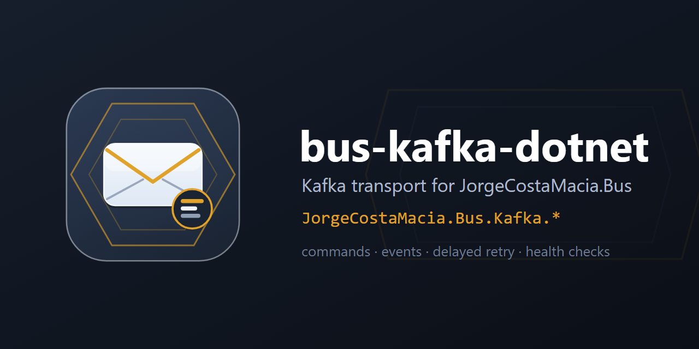

  

# bus-kafka-dotnet

> The Kafka transport of [JorgeCostaMacia.Bus](https://github.com/JorgeCostaMacia/bus-dotnet) — the command/event bus over Confluent.Kafka, with Quartz-backed delayed retry and health checks — each scoped to a single concern and shipped independently under `JorgeCostaMacia.Bus.Kafka.*`.

A MassTransit-free bus: the contracts live in [bus-dotnet](https://github.com/JorgeCostaMacia/bus-dotnet), the other transport in [bus-rabbitmq-dotnet](https://github.com/JorgeCostaMacia/bus-rabbitmq-dotnet), and each releases on its own. Part of the `JorgeCostaMacia.*` family, alongside [ddd-dotnet](https://github.com/JorgeCostaMacia/ddd-dotnet), [quartz-dotnet](https://github.com/JorgeCostaMacia/quartz-dotnet), [serilog-dotnet](https://github.com/JorgeCostaMacia/serilog-dotnet) and [http-dotnet](https://github.com/JorgeCostaMacia/http-dotnet).

## Requirements

The **.NET 10** SDK.

## Packages

| Package | What it does |
| --- | --- |
| [JorgeCostaMacia.Bus.Kafka](https://www.nuget.org/packages/JorgeCostaMacia.Bus.Kafka/) | Transport on `Confluent.Kafka` — commands (`Send`) and events (`Publish`). |
| [JorgeCostaMacia.Bus.Kafka.Retry.Quartz](https://www.nuget.org/packages/JorgeCostaMacia.Bus.Kafka.Retry.Quartz/) | Quartz-backed delayed retry for the transport — parks a failed delivery and re-produces it at its time. |
| [JorgeCostaMacia.Bus.Kafka.HealthChecks](https://www.nuget.org/packages/JorgeCostaMacia.Bus.Kafka.HealthChecks/) | Health check for the transport — the bus's broker reachability on ASP.NET Core health endpoints. |

## Upgrading

What each version asks of you, when it asks anything, is in [CHANGELOG.md](CHANGELOG.md).

## Contact

- [LinkedIn](https://www.linkedin.com/in/jorge-costa-macia-842817164/)
- [GitHub](https://github.com/JorgeCostaMacia/)
- [Bitbucket](https://bitbucket.org/jorgecostamacia/)
